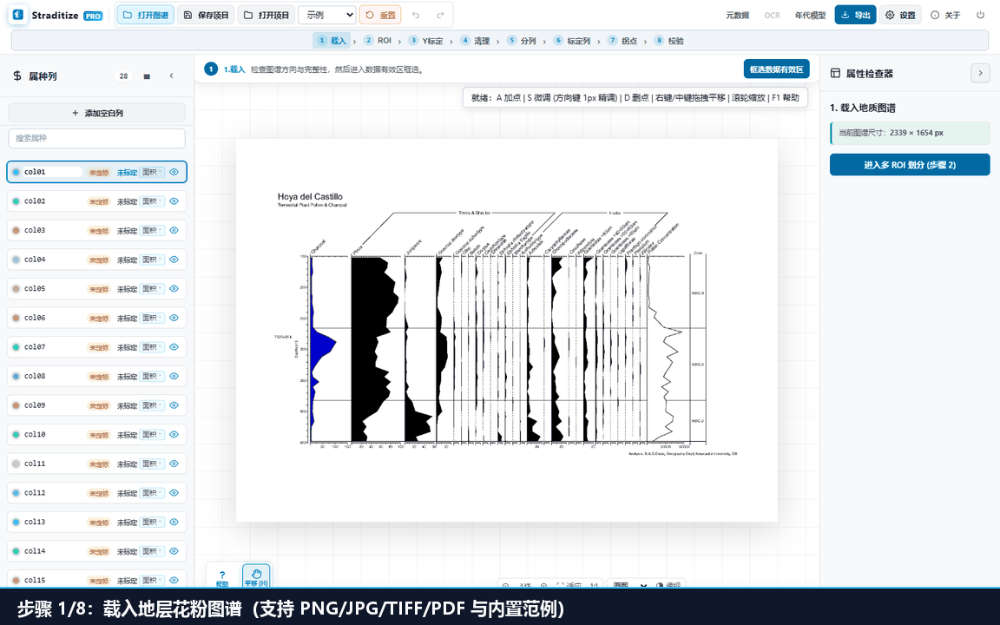

# Straditize Pro (v2.0)

<p align="center">
  <picture>
    <source media="(prefers-color-scheme: dark)" srcset="docs/assets/logos/logo-horizontal-dark.svg">
    <source media="(prefers-color-scheme: light)" srcset="docs/assets/logos/logo-horizontal-light.svg">
    
  </picture>
</p>

<p align="center">
  <strong>把地层与花粉图谱还原成深度对齐的数据矩阵</strong><br>
  <em>Digitizing stratigraphic and palynological diagrams into depth-aligned data matrices</em>
</p>

<p align="center">
  <a href="https://chmzs.github.io/straditize-pro/"></a>
  <a href="https://github.com/chmzs/straditize-pro/releases/latest"></a>
  
  
  
  
  
  
</p>

<p align="center">
  <a href="https://chmzs.github.io/straditize-pro/"><strong>官方主页与在线文档</strong></a> &nbsp;|&nbsp;
  <a href="https://github.com/chmzs/straditize-pro/releases/latest"><strong>下载发行包（Windows / macOS / Linux）</strong></a> &nbsp;|&nbsp;
  <a href="#8-阶段科学解译工作流"><strong>8 步解译工作流</strong></a> &nbsp;|&nbsp;
  <a href="https://chmzs.github.io/straditize-pro/tutorials/01_quickstart.html"><strong>在线实战教程 (HTML)</strong></a>
</p>

---

## 为什么需要 Straditize Pro

地层剖面与花粉图谱的数据大量以**图表形式（文献扫描件或光栅图）**保存在论文与专著中。图像本身不能直接进入定量分析：要参与统计与成图，需要逐列定位曲线、标定刻度、对齐深度。

---

### 地学多指标复合图谱（Polydiagrams）数字化的七个问题

地层图谱（花粉剖面图、微体古生物图、沉积物岩性多指标图）与单曲线 X-Y 折线图有七处差别：

1. **多列并列，通用工具按单列处理**  
   一张地层图谱并列展示数十个分类属种（Taxa）及地球化学指标（炭屑、元素比值、同位素 $\delta^{13}\text{C}$、磁化率等）。通用工具按“单图单曲线”设计：每个属种要新建一个数据集、各自标定一次坐标系。
2. **点位非对齐产生“伪空值（Pseudo-NA）”**  
   通用工具在每条曲线上独立采点，各属种的深度坐标因此错位。横向拼接汇总表时，矩阵中出现由采点未对齐引入的虚假缺失值（`NA`）。下游分析包（R 语言 `rioja::strat.plot`、`vegan::cca`、CONISS 约束层次聚类）遇到 `NA` 会剔除整行或整列，只能人工拉平或插值。
3. **背景杂线与数据曲线粘连**  
   地层图谱中普遍存在密集的水平沉积相分带线、岩性花纹图例、深度网格辅助线及曲线填充阴影。通用工具的二值化与骨架提取会把网格线当成数据曲线；改成去线时，又会把狭窄的花粉条带一并切断。
4. **拉丁属种名称靠手工录入**  
   每个属种列顶部的拉丁学名通常以 30°、45° 或 60° 倾斜排版，通用 OCR 无法自动定位。研究人员只能手工录入数十个拉丁分类单元（如 *Pinus canariensis*, *Artemisia*, *Chenopodiaceae*, *Betula alba*）；拼写错误会直接导致与古生物分类库匹配失败。
5. **多尺度混排与非线性区间**  
   地层图谱常在一张图内混排不同尺度的属种（如优势属种 0-60%、微量属种 0-5%、夸大放大曲线 5×/10×，甚至对数 Log 浓度轴与负值同位素轴）。通用工具把整图或选框统一映射为 0-100%，微量属种被压扁，夸大曲线的数值失真。
6. **年代学不确定性无法随数据传递**  
   地层剖面通常附带放射性碳测年（$^{14}\text{C}$）与贝叶斯沉积年代-深度模型（Bacon / Bchron）。通用工具不提取年代中位数与 95% 置信包络，也不生成 1000 集合年代学；年代误差因此停在图里，进不了下游序列重建，也不满足 LiPD 与 FAIR 的字段要求。
7. **结果不可复现，格式不标准**  
   通用工具导出的是孤立的散点坐标表，没有原图、矢量标定元数据与工程归档。同行评议无法复核提取过程，也没有现成的绘图脚本。

---

### 主流图表数值化提取工具对比

| 对比维度 | WebPlotDigitizer (WPD) | Origin 内置 Digitizer | GetData Graph Digitizer | Engauge Digitizer | Straditize (原版 v1.x) | **Straditize Pro (v2.0)** |
| :--- | :--- | :--- | :--- | :--- | :--- | :--- |
| **设计定位** | 通用 Web/桌面 X-Y 曲线数字化 | OriginLab 科学制图套件内置插件 | 商业共享软件 (Windows 专享) | 跨平台开源单图数字化工具 | 地层花粉图谱初版原型 (Sommer 2019) | **面向地层图与花粉图的多列数字化工具** |
| **多列图谱 (Polydiagrams)** | ❌ 需为几十列反复手工新建 Dataset | ❌ 仅限单个坐标系，多列需建几十个图层 | ❌ 纯单图单轴思维，需按列分别截图加载 | ❌ 单曲线模式，无多列排版管理概念 | ⚠️ 支持分列；多列时界面卡顿 | **✅ 全剖面多列并发管理，基线自动探测与拖拽联动** |
| **等深采样对齐机制** | ❌ 各曲线独立采点，深度坐标参差错位 | ❌ 沿点抓取，各列 Y 坐标完全不一致 | ❌ 离散散点输出，无层位概念 | ❌ 离散点位，无层位概念 | ⚠️ 依赖有限插值网格，存在局部漂移 | **✅ 等深横向截交，提取全属种共识深度** |
| **数据矩阵质量** | ❌ 拼表充斥伪 `NA`，直接导致下游报错 | ❌ 导出各列长度不一，需手工对齐清洗 | ❌ 散乱坐标点，需在 Excel 重组拼表 | ❌ 导出散点表，无法直接成矩阵 | ⚠️ 部分极值点可能漏检 | **✅ 未检出层位赋 0.00，不产生伪 NA** |
| **水平分带/网格去线** | ❌ 仅普通二值化，极易混淆背景横线 | ❌ 无网格剔除算法，易抓取网格交点 | ❌ 手工橡皮擦点选涂抹 | ❌ 仅简单色彩滤镜，横线依然粘连 | ⚠️ 基于后台脚本批处理，缺乏交互透视 | **✅ 去线算法 + `B` 键二值化透视遮罩** |
| **属种名称提取** | ❌ 纯手工盲打输入每一个拉丁属名 | ❌ 无文字识别功能，纯手工键入 | ❌ 无文字识别功能 | ❌ 无文字识别功能 | ❌ 无属种 OCR 支持 | **✅ PP-OCRv6 离线识别 + 内置中拉学名词库纠错** |
| **物理刻度标定** | ⚠️ 依赖手动选框，每列重复点选 | ⚠️ 需手动定义 X1/X2/Y1/Y2 四点轴线 | ⚠️ 手工设置单轴极值 | ⚠️ 单一直角坐标系映射 | ⚠️ 相对比例标定，小刻度属种易失真 | **✅ 两点式物理刻度钉（原点+刻度齿）+ 对数 Log 校验** |
| **年代-深度模型提取** | ❌ 完全不支持，仅作普通折线处理 | ❌ 不支持年代学不确定性建模 | ❌ 不支持 | ❌ 不支持 | ❌ 仅提取花粉曲线 | **✅ 提取 Bacon 95% 置信包络并重构 1000 集合年代学** |
| **下游生态与数据标准** | ⚠️ 导出离散 CSV，需大量清洗拉平 | ⚠️ 导出 Origin Worksheet，无标准化 | ⚠️ 导出无格式文本，无生态学绑定 | ⚠️ 纯文本坐标点 | ⚠️ 需用户自行编写复杂 R 代码绘图 | **✅ 导出 `rioja::strat.plot` 脚本 + LiPD** |
| **运行架构与部署** | Web 浏览器 / Electron 桌面打包 | 需商业授权购买完整 OriginLab 软件 | 商业闭源共享软件 (需注册码) | C++/Qt 本地编译安装 | 依赖复杂 Python+PyQt5 本地环境 | **✅ Windows（Setup / 便携版）/ macOS（Apple Silicon / Intel）/ Linux（deb / rpm / tar.gz）预编译包，或浏览器直接打开；视口为 HTML5 Canvas 2D** |

---

### Straditize Pro 的解决方案
**Straditize Pro** 把一份图谱拆成 8 步处理：Radon 变换检测并矫正扫描倾角，自动提取水平分带线，PP-OCRv6 识别倾斜排版的拉丁学名，Y 轴与 X 轴各做一次两点式物理标定，等深截交生成全属种共识层位，最后按 Σ% 门禁校验后导出矩阵。

---

## 核心特性

### 1. 自动化地层视觉与专属古生物 OCR
- **倾斜自动校正**：基于 Radon 变换检测扫描倾角；检出的倾角 ≥ 0.3° 时提示旋转校正，按检测角度转回水平。
- **去线与二值化透视**：滤除水平分带线与背景网格；`B` 键切换二值化透视遮罩，白色为保留像素、红色为被剔除像素。
- **PP-OCRv6 属种名称提取**：离线拉丁学名识别引擎，支持倾斜文本；内置花粉、硅藻与微体古生物中拉对照词库，对识别结果做模糊匹配与拼写纠错。

### 2. 两点式物理刻度与统一解析管道
- **物理刻度标定**：刻度钉锚定基线原点与任意已知刻度齿，与取数区边框解耦，主属种与微量属种各用各的刻度跨度。
- **线性与对数尺度**：两种比例都支持；起点 ≤ 0 时对数选项被禁用并给出提示，避免 $\ln(0)$ 进入换算。

### 3. 等深截交与零 NA
- **全属种共识深度对齐**：沿连续地层剖面，以统一采样深度网格横向截交全部分类单元的轮廓多边形。
- **未检出层位填 0**：对未检出或低于检出限的层位填 `0.00`，矩阵中不出现 `NA`。

### 4. 内置年代-深度模型提取与不确定性传递
- **曲线中位数与包络自动提取**：从图谱中直接解译 Bacon 或 Bchron 沉积年代模型的中位数曲线及 95% 置信区间。
- **1000 集合年代学重构**：基于速率空间高斯过程与单调先验，自动生成 1000 条年代学集合，完整打包进国际古气候标准 **LiPD v1.3** 格式。

### 5. 免安装运行与 R 语言导出
- **出图脚本**：导出可直接运行的 R 语言 `rioja::strat.plot` 脚本，脚本读取导出的 CSV。
- **多格式导出与百分和校验**：支持导出 CSV、多表头 Excel、JSON、LiPD 及开放 POSIX UStar `.tar` 归档工程包；导出前按 Σ% ≤ 102%（100% + 容差 2%）检查各层位百分比总和。
- **跨平台与运行架构**：Windows x64、macOS（Apple Silicon / Intel）、Linux x64 四种产物均内嵌运行时；后端计算与前端画布分离，同一后端可被局域网内的移动设备访问。

---

## 工作流演示



> *实机录制：在浏览器画布中走完 8 步——载入、框有效区、Y 轴两点标定、清理、分列、X 刻度标定、拐点层位、校验/导出。*

---

## 8 阶段科学解译工作流

工作流由状态机驱动，已完成的步骤可以随时回跳修改：

```
[1. 载入] → [2. 有效区(ROI)] → [3. Y 轴两点标定] → [4. 清理] → [5. 分列] → [6. X 刻度标定] → [7. 拐点层位] → [8. 校验/导出]
```

| 步骤 | 该步做什么 | 对应的问题 |
| :---: | :--- | :--- |
| **1. 载入** | 支持 PNG、JPG、TIFF、WebP 及单页 PDF；Radon 变换检测并矫正扫描倾角。 | 扫描或翻拍引入的几何微倾斜。 |
| **2. 有效区(ROI)** | 多取数区（Multi-ROI）管理，把有效剖面与图名、图例、深度标尺、聚类树分开。 | 外部文字与树状图不参与曲线识别；一张图可切成多块分别解译。 |
| **3. Y 轴两点标定** | 两点映射深度或年代坐标，可选单位（cm、m、cal yr BP），支持正反向递增。 | 取数区边框不再被当作坐标极值；深度由标定值给出。 |
| **4. 清理** | 自动提取水平沉积边界线；`B` 键切换二值化透视遮罩；保护阈值防止切断实心花粉带。 | 网格线与分带线不进入识别，连续花粉轮廓保留。 |
| **5. 分列** | 自动识别属种列基线；PP-OCRv6 离线识别配合中拉对照词库做模糊纠错。 | 几十个拉丁分类单元名称不必逐列手打。 |
| **6. X 刻度标定** | 两点式刻度钉标定；按列组同步应用；对数尺度做数学有效性校验。 | 各属种按自己的刻度还原变化幅度（主成分 50% 与微量属种 5% 不同尺度）。 |
| **7. 拐点层位** | 提取轮廓拐点与多边形；提取全属种共识采样层位；可提取 Bacon 年代-深度模型。 | 光栅轮廓转为矢量坐标；年代中位数与 95% 置信包络随层位一起导出。 |
| **8. 校验/导出** | 按 Σ% ≤ 102% 检查各层位百分比总和；导出无空值 CSV、Excel、LiPD 及 `rioja` 绘图脚本。 | 百分比总和不超标才放行导出；导出件可直接交给 R 做统计与成图。 |

---

## 下载与使用

### 1. 预编译发行包（Windows / macOS / Linux）

前往 [**GitHub Releases**](https://github.com/chmzs/straditize-pro/releases/latest) 下载对应平台的预编译包。三个平台的发行包都已内嵌完整 Python 运行时、ONNX Runtime 视觉推理引擎与 PP-OCRv6 模型权重，**目标机器无需预装 Python 或 Node.js**。

| 平台 | 版本类型 | 文件名（以 v2.0.4 为例） | 说明 |
| :--- | :--- | :--- | :--- |
| **Windows x64** | 安装包（推荐） | `Straditize-Pro-v2.0.4-Windows-x64-Setup.exe` | 双击安装，自动创建开始菜单与桌面快捷方式，按用户安装、无需管理员权限。 |
| **Windows x64** | 绿色便携版 | `straditize-v2.0.4-windows-x64-portable.zip` | 解压到任意目录，双击 `straditize.exe` 运行；适合 U 盘随身携带或实验室公用电脑。 |
| **macOS（Apple Silicon）** | 便携压缩包 | `straditize-v2.0.4-macos-arm64.tar.gz` | 适配 M1–M4 等 Apple Silicon 机型。解压后运行包内的 `straditize`。首次运行需在「系统设置 → 隐私与安全性」放行（未签名发行包）。 |
| **macOS（Intel x86_64）** | 便携压缩包 | `straditize-v2.0.4-macos-x64.tar.gz` | 适配 2020 年及更早的 Intel Mac（Core i5/i7/i9）。用法同上：解压后运行包内 `straditize`，首次需 `chmod +x` 并在系统设置中放行。 |
| **Linux x64** | Debian / Ubuntu | `straditize_2.0.4_amd64.deb` | `sudo apt install ./straditize_2.0.4_amd64.deb`，或 `sudo dpkg -i` 后补依赖。 |
| **Linux x64** | Fedora / RHEL / CentOS | `straditize-2.0.4-1.x86_64.rpm` | `sudo rpm -i straditize-2.0.4-1.x86_64.rpm`。 |
| **Linux x64** | 通用便携压缩包 | `straditize-v2.0.4-linux-x64.tar.gz` | 不挑发行版，解压后直接运行包内的 `straditize`；适合无 root 权限的集群登录节点。 |

> macOS 与 Linux 发行包首次运行若提示无执行权限：`chmod +x ./straditize`。
> 四种平台/架构产物（Windows、macOS arm64、macOS x64、Linux）由 `.github/workflows/build-release.yml` 在打 tag 时自动构建并上传，版本号取自 tag。

---

### 2. 源码安装与开发者模式

#### 环境依赖
- **Python**: `>= 3.12`
- **Node.js**: `>= 20`
- **环境管理工具**: 推荐使用 [Pixi](https://pixi.sh) 或 Conda

#### 快速启动
```bash
# 1. 获取项目代码
git clone https://github.com/chmzs/straditize-pro.git
cd straditize-pro

# 2. 安装依赖并构建前端
pixi run install
npm --prefix frontend install
npm --prefix frontend run build

# 3. 启动应用 (自动唤起默认浏览器)
pixi run app
```

*(Windows 开发者亦可在项目根目录双击 `start_straditize.bat` 脚本启动)*

---

## 实战教程

- [教程一：8 步走完古生态图谱数字化全流程 (在线 HTML)](https://chmzs.github.io/straditize-pro/tutorials/01_quickstart.html) ｜ [本地 Markdown 源码](docs/tutorials/01_quickstart.md)
- [教程二：两点式物理刻度钉标定与对数（Log）曲线实战 (在线 HTML)](https://chmzs.github.io/straditize-pro/tutorials/02_twopoint_calibration.html) ｜ [本地 Markdown 源码](docs/tutorials/02_twopoint_calibration.md)
- [教程三：数据导出规范、无 NA 矩阵与 R 语言 riojaPlot 成图 (在线 HTML)](https://chmzs.github.io/straditize-pro/tutorials/03_export_and_riojaplot.html) ｜ [本地 Markdown 源码](docs/tutorials/03_export_and_riojaplot.md)

---

## 远程协作与多设备支持

两种部署方式，按实验室硬件条件选：

- **平板与移动端局域网标注**：在主控机设置面板中开启“局域网连接”并配置访问 PIN 码，即可在同一 WiFi 下用 iPad 或触摸平板做手写标注与图谱审查。
- **远程服务器与算力中心部署**：通过原生命令行模式在服务器后台运行，配合 SSH 端口转发（`ssh -L 8765:127.0.0.1:8765 user@remote`），本地浏览器经 SSH 隧道访问该服务。

---

## 研发团队与联系方式 (Author & Contact)

- **主要开发者 / 维护人**：**陈鸿明** (Hongming Chen)
  - GitHub: [@chmzs](https://github.com/chmzs)
  - 联系邮箱：[chmzs@outlook.com](mailto:chmzs@outlook.com)
- **科研单位**：**兰州大学资源环境学院 黄小忠课题组** (College of Earth and Environmental Sciences, Lanzhou University, Huang Xiaozhong's Research Group)
- **课题组学术指导与通讯作者**：
  - 黄小忠 (Xiaozhong Huang) &nbsp;|&nbsp; 邮箱：[xzhuang@lzu.edu.cn](mailto:xzhuang@lzu.edu.cn)
  - 向丽雄 (Lixiong Xiang) &nbsp;|&nbsp; 邮箱：[xianglx@lzu.edu.cn](mailto:xianglx@lzu.edu.cn)

---

## 学术引用与开源许可 (Citation & License)

本项目基于 **GNU General Public License v3.0 or later (GPL-3.0-or-later)** 开源。

如在学术论文、学位论文、古气候定量重建或科学专著中使用了 Straditize Pro，请按如下规范引用：

### 第一引用（Primary Citation - 本软件系统）：
- **中文格式**：  
  陈鸿明, 向丽雄\*, 王文佳, 欧阳瑶, 闫创子, 李鹏宇, 黄小忠\*. (2026). *Straditize Pro: 专业地层花粉与古气候图表数字化科研解译系统 (v2.0)* [CP/OL]. 兰州大学资源环境学院 黄小忠课题组. https://github.com/chmzs/straditize-pro (*通讯作者).
- **英文格式**：  
  Chen, H., Xiang, L.\*, Wang, W., Ouyang, Y., Yan, C., Li, P., & Huang, X.\* (2026). *Straditize Pro: Next-Generation Scientific Digitization System for Palynological & Stratigraphic Diagrams (v2.0)*. College of Earth and Environmental Sciences, Lanzhou University (Huang Xiaozhong's Research Group). https://github.com/chmzs/straditize-pro (*Corresponding authors).
- **BibTeX 格式**：
```bibtex
@software{straditize_pro_2026,
  author       = {Chen, Hongming and Xiang, Lixiong and Wang, Wenjia and Ouyang, Yao and Yan, Chuangzi and Li, Pengyu and Huang, Xiaozhong},
  title        = {Straditize Pro: Next-Generation Scientific Digitization System for Palynological \& Stratigraphic Diagrams (v2.0)},
  year         = {2026},
  institution  = {College of Earth and Environmental Sciences, Lanzhou University},
  url          = {https://github.com/chmzs/straditize-pro},
  license      = {GPL-3.0-or-later},
  note         = {Huang Xiaozhong's Research Group. *Corresponding authors: Lixiong Xiang (xianglx@lzu.edu.cn), Xiaozhong Huang (xzhuang@lzu.edu.cn)}
}
```

### 第二引用（Secondary Citation - 基础理论与算法原型）：
- Sommer, P. S. (2019). *Straditize: A Python package for digitizing pollen diagrams*. Journal of Open Source Software, 4(34), 1216. [doi:10.21105/joss.01216](https://doi.org/10.21105/joss.01216).
```bibtex
@article{sommer2019straditize,
  author       = {Sommer, Philipp S.},
  title        = {Straditize: A Python package for digitizing pollen diagrams},
  journal      = {Journal of Open Source Software},
  volume       = {4},
  number       = {34},
  pages        = {1216},
  year         = {2019},
  doi          = {10.21105/joss.01216}
}
```
