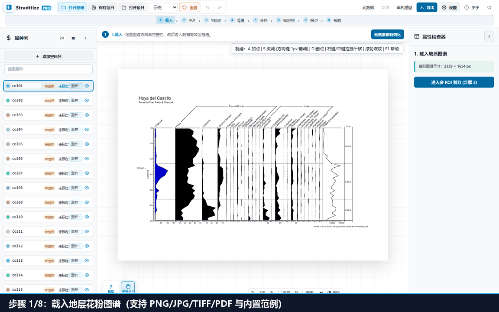

# 教程 1：8 步走完古生态图谱数字化 (全流程)

本教程用 **Straditize Pro v2.0** 的 8 阶段解译工作流，把一张地层花粉、微炭屑与古气候图谱扫描件解译成数据矩阵。

---

## 阶段概览：8 步解译工作流

顶部导航条提供 8 个状态胶囊，已完成标记为 `✓`，当前进行中为 `●`，未开始为 `○`：

```
[1.载入] → [2.ROI] → [3.Y标定] → [4.清理] → [5.分列] → [6.标定列] → [7.拐点] → [8.校验]
   ✓          ✓          ✓         ✓           ✓              ✓               ✓               ●
```

已完成的步骤胶囊可以点击跳回修改；右侧步骤面板底部有推进按钮。



---

## 步骤 1：载入图谱

1. **载入方式**：
   - 点击顶栏 **[打开图谱]** 按钮选择本地文件（支持 PNG / JPG / TIFF / WebP / 单页 PDF）；
   - 或者直接将图片拖拽至中央画布虚线框释放；
   - 快速体验：在顶栏 **“示例”** 下拉菜单中选择 **`Hoya`** 或 **`Beginner`** 剖面。
2. **大图与微斜检查**：
   - **尺寸上限**：超过 8000×12000 px 时弹出拦截窗口，可选按 50% 降采样加载，或中止加载；
   - **微斜检测 (Radon Deskew)**：载入后做一次氡变换倾角检测。检出 $\ge 0.3^\circ$ 的倾角时，右上角滑出提示横幅，点击 **[旋转校正]** 按该角度转回水平。
3. **完成加载**：图片自适应居中，进入步骤 2。

---

## 步骤 2：框选有效区 (ROI)

1. 工具栏自动激活 **ROI 模式**（快捷键 `R`）；
2. 画布上呈现 8 个方块控制手柄：
   - 拖拽手柄对齐花粉数据区边界；
   - **地学规范**：**把左侧纵坐标轴线、右侧聚类分析树 (CONISS) 与底部刻度排除在框外**；
   - 边框标签只报**像素范围**（如 `ROI Y: 511px - 1311px`）——有效区不携带任何深度含义；
3. **多有效区 (Multi-ROI) 支持**：
   - 如果图谱包含主花粉丰度区、炭屑浓度区或磁化率附图，可在右侧面板点击 **[＋ 新建有效区]** 分块管理；
   - 每个有效区有独立的名称、分列集合与百分比组合属性（`composition=true/false`）；
4. 点击右侧面板 **[确认有效区，进入 Y 轴标定]** 推进。

---

## 步骤 3：Y 轴两点标定（深度 / 年代轴）

> ⚠️ **Y 轴标定与有效区 (ROI) 解耦**。未标定时界面显示 `--`，不会拿有效区边框当刻度。

1. **两点标定操作**：
   - 在图上找到 Y 轴两个已知刻度水平线（例如 `0 cm` 与 `150 cm` 所在行）；
   - 在面板填入两点的像素行与真实物理数值及单位（`cm` / `m` / `cal yr BP` 等）；
   - 支持向下递增（深度）与向上递增（年代）；
2. **标定参考可视化**：
   - 画布呈现黄色半透明标定跨度带与两条 ⚑ 刻度基准线，超出该跨度的层位自动作为外推区标记；
3. 点击右侧面板 **[确认标尺，进入干扰线清理]** 推进。

---

## 步骤 4：清理干扰线与网格 (Cleanup)

1. 点击 **[自动扫描候选线]**，后端检测水平分带线与网格线；
2. **即时透视遮罩 (B 键)**：
   - 按下键盘 **`B`** 键，画布开启双色二值化透视遮罩：
   - ⚪ **白色**：保留下来的花粉轮廓与墨迹；
   - 🔴 **红色**：被剔除的线像素（遮罩由后端原样返回，分列只认没被遮掉的像素）；
3. **排除框与画笔微调**：
   - 复杂图表可添加 **排除区 (Exclusion Rect)** 保护图注或特征区域；
   - 使用修正画笔手工擦除误标或补标漏线，松手即刻触发后端增量重算；
4. 点击右侧面板 **[确认清理，开始自动分列]** 推进。

---

## 步骤 5：分列与属种命名 (Naming)

1. 系统在纯数据区内自动探测属种垂直基线（虚线显示）；
2. **属种名单对齐与批量导入**：
   - 行内点击列标题快速重命名；
   - 点击 **[批量导入]**，直接粘贴来自文献表格的多行属种名单，自动从左到右匹配；
3. **离线 PP-OCRv6 属种识别**：
   - 点击顶栏 **[OCR]**；
   - 支持 0°/30°/45°/60° 旋转投影识别倾斜标签；
   - 内置花粉、硅藻、微体古生物 (NPP) 中拉对照词库，对识别结果做模糊匹配与拼写纠错；
   - 支持粘贴期刊图版说明（Plate caption）一键解析并保存自定义属种词条；
4. 点击右侧面板 **[确认列命名，进入 X 轴刻度标定]** 推进。

---

## 步骤 6：X 轴两点物理刻度标定与列组

1. **两点式物理标定 (Two-Point Tick Calibration)**：
   - **端点 1 ($P_1$)**：列基准原点，通常为 `0%`（对数尺度为起始正数）；
   - **端点 2 ($P_2$)**：印刷刻度齿，在图上填入真实读数（如 `20%`、`50%`、`100%`），拖拽画布橙色刻度手柄对齐；
2. **列组 (Column Groups) 统一管理**：
   - 同属一个刻度规范的属种列（如均为 0-20%）可归入同一列组，一次调参、全组自动应用；
3. **尺度与对数保护**：
   - 炭屑或浓度指标可切换对数尺度 (Log Scale)；
   - 起点 $\le 0$ 时 Log 选项被禁用并红字提示，$\ln(0)$ 不会进入换算；
4. 点击右侧面板 **[确认列刻度，提取拐点与采样层位]** 推进。

---

## 步骤 7：拐点与采样层位

1. 系统提取轮廓边缘并压缩成拐点；
2. **层位共识提取**：
   - 点击 **[自动提取共识层位]**，系统分析各属种波峰与基线的相交位置，生成采样层位矩阵；
   - 支持单行删除与层位深度微调；
3. **年代-深度模型提取 (Age-Depth Model)**：
   - 点击顶栏 **[年代模型]**，载入图谱附带的 Bacon 或 Bchron 年代图；
   - 自动追踪中位数年代曲线与 95% 置信包络区间；
   - 按贝叶斯先验生成 1000 条单调年代学集合，按层位深度对齐；
4. 点击右侧面板 **[完成提取，进入全剖面地学校验]** 推进。

---

## 步骤 8：校验诊断与导出

1. **地学质量把关 (QA Diagnostics)**：
   - **百分比和门禁 (Σ%)**：检验全剖面各层位百分比加和，上界为 100% + 容差 2.0%，超限与空层位会被标出；
   - **未标定列警示**：属种列未标定刻度时给出 ⚠️ 状态，导出就绪清单会拦下；
2. **FAIR / LiPD v1.3 标准元数据录入**：
   - 点击顶栏 **[元数据]**，录入文献 DOI、站点经纬度、水深、孔长、采集人与基金信息；
   - 支持**外部 AI 免 Token 导入助手**：一键复制结构化 Prompt，粘贴外部网页 AI 解读结果即刻自动解析回填；
3. **多格式科研成果一键导出**：
   - **`[下载 CSV]`**：无 NA 地层百分比矩阵；
   - **`[导出多表 Excel]`**：每个有效区独立 Sheet，附带综合统计与元数据；
   - **`[导出 LiPD]`**：LiPD v1.3 格式（含测量表与年代集合）；
   - **`[导出 TAR 包]`**：POSIX UStar 项目包，含双原图、JSON 矢量模型与中间态，解压后不依赖其他文件；
   - **`[R 脚本]`**：生成 `plot_strat.R`，读导出的 CSV 后用 `rioja::strat.plot()` 出图。

---

## 附录：多设备协作与远程访问密码保护

在工作站启动系统后，可用 iPad 或笔记本通过局域网访问：
1. 宿主机顶栏点击 **`设置`** $\to$ **`远程访问`**；
2. 勾选 **“允许局域网远程连接”**，并输入自拟的 **“远程访问保护密码”**（如 `lab2026`）；
3. iPad 浏览器直接输入工作站的局域网 IP（如 `http://192.168.1.100:8765`）；
4. 弹出 **远程保护锁屏**，输入密码解锁进入解译界面；路由器 IP 变动后按新地址访问即可。本机回环访问免密。
