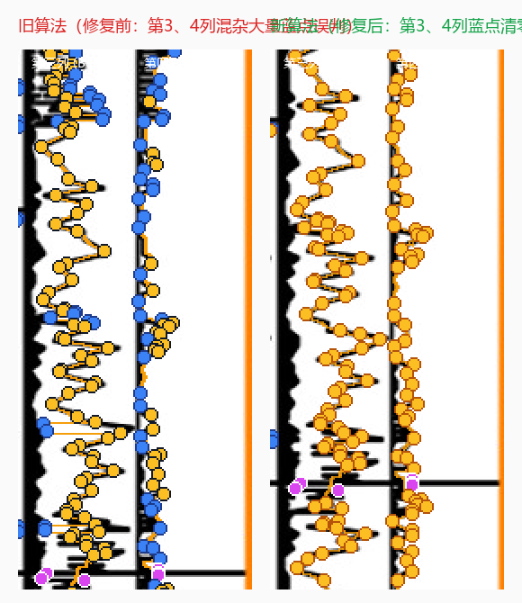
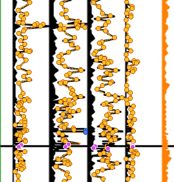

# 教程 4：双轨夸大曲线（Nx 细线）与极端大峰物理截断提取实战

在第四纪地质学与花粉分析（Pollen Analysis）图谱中，属种丰度往往极其悬殊：
- **占优属种**（如松属 *Pinus*、蒿属 *Artemisia*）丰度常超过 30%~60%；
- **微量或环境指示属种**（如白刺属 *Nitraria*、麻黄属 *Ephedra*、栎属 *Quercus*）通常仅有 0.5%~2.0%。

为了在同一张图谱中兼顾两类属种，地学期刊与专业软件（如 Tilia、TGView、rioja）普遍采用**双轨夸大制图法则**：
1. **主曲线（内线，1x 实心黑色填充）**：紧贴零轴的实体轮廓，表达真实的 1x 丰度；
2. **夸大曲线（外线，通常为 5x 或 10x 独立细折线）**：将微量起伏放大 5 倍或 10 倍绘制，便于肉眼辨识；
3. **极端大峰物理截断**：当花粉在大暖期爆发式增长时，外线若继续放大 5 倍将严重飞出该属种列界并遮挡相邻列，此时制图规范会**省略/截断外线**，直接展示贴轴的 1x 实心轮廓。

**Straditize Pro** 引入了专属的 `area_exaggerated` 读取策略与真实物理截断模型，实现全自动高保真提取。

---

## 1. 物理模型与三色视觉分级系统

为了让用户在画布上一目了然地检查算法判定结果，Straditize Pro 建立了三色控制点视觉分级体系：

| 控制点颜色 | 对应来源标记 (`source`) | 物理含义与数值换算规则 |
| :--- | :--- | :--- |
| 🟡 **经典黄 (Amber)** | `exagg_Nx`（如 `exagg_5x`） | **正常夸大外线点**：控制点 1:1 精准咬合在图谱外侧 5x 细线骨架上，导出与表格计算时统一自动除以 $N$（如 $\div 5$）换算为 1x 真实丰度。 |
| 🔵 **科技蓝 (Blue)** | `main_1x` | **真实截断内线点**：仅当大峰爆发、内线实心黑块自身宽度占据列宽 45% 以上且贴死列右分割线时触发。直接抓取内线黑块边缘作为 1x 原值，不再除以 $N$。 |
| 🟣 **品红高亮 (Magenta)** | `manual` | **人工微调点**：用户在画布上直接单击添加或拖拽调整的控制点，拥有最高优先级。 |

---

## 2. 操作工作流

### 步骤一：Step 6（列标定）统一配置组夸大属性
1. 进入工作流 **第 6 步：列标定 (XTicks)**；
2. 在右侧 **组标定卡片**（如花粉大组）中，找到 **放大倍数 (Exaggeration Multiplier)**；
3. 输入底图对应的夸大倍率（例如输入 `5`）；
4. 当设置了放大倍数（$> 1$）时，系统自动展开 **夸大样式 (Exaggeration Style)** 选项：
   - **`线条 (Line)`**（默认）：适用于细折线夸大。算法会自动计入墨迹线宽，取中心骨架坐标 `(start + end) / 2.0`；
   - **`填充 (Area)`**：适用于浅色/半透明灰色块夸大。算法会取最外侧轮廓边缘。
5. 点击切换样式，组内所有属种列自动继承，Step 7 无需反复繁琐配置。

### 步骤二：Step 7（特征提取与控制点检查）
1. 进入工作流 **第 7 步：取样点与控制点提取 (Samples & Digitization)**；
2. 算法自动启用双轨高保真提取器，画布上：
   - 绝大多数连续波峰、波谷与微小起伏均呈现 **黄色控制点**，精确咬合在原图 5x 细线上；
   - 极端爆发的大波峰（如整列满格涂黑段）呈现 **科技蓝控制点**，原值锁定。
3. 若底图存在破损、污迹或遮挡，可随时使用鼠标左键单击补充控制点，或拖拽黄色/蓝色点进行微调（自动变为品红高亮）。

---

## 3. 科学安全保障机制

1. **大波峰触界保护（杜绝削峰断崖）**：
   旧算法常因外线峰顶触碰列右分割线而误判为截断，造成原本 60px 的外线峰顶断崖式向左塌陷 50px 到内线打蓝点。新算法通过 `inner_width >= 0.45 * W_col` 判定，完整保留外线峰顶数据。
2. **微量属种连续性保护**：
   在栎属等低丰度属种中，即使外线起伏较小，算法仍能稳定捕获 5x 连续外线，杜绝误杀全列泛蓝。
3. **数值单一事实源**：
   画布点位坐标保持与原图 1:1 一致，便于肉眼校验；数值换算全部在统一入口（`read_column_values`）自动完成，导出数据真实无偏。
